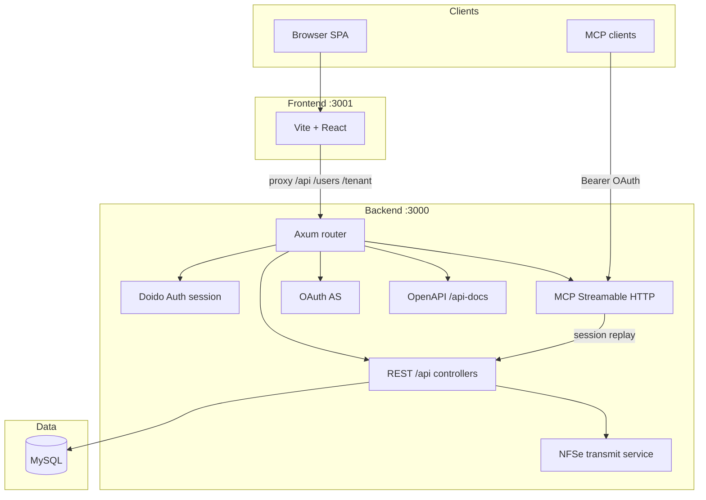

# Architecture overview

## Components

| Layer | Technology | Location |
|-------|------------|----------|
| HTTP server | Doido + Axum | `backend/config/routes.rs` |
| Domain API | Controllers + SeaORM | `backend/app/controllers/api/` |
| Multi-tenancy | Session `empresa_id` | `backend/app/auth/tenant.rs` |
| DTOs | Serialize types | `backend/app/services/dto.rs` |
| NFSe transmission | HTTP + XML | `backend/app/services/nfse/` |
| SPA | React 19, TanStack Query | `frontend/src/` |
| UI | Tailwind v4, shadcn/ui | `frontend/src/components/ui/` |

## Request flow (browser)

1. User signs in → `POST /users/sign_in` → encrypted cookie.
2. User picks empresa → `POST /tenant/empresa` → tenant stored in session.
3. CRUD calls → `/api/*` scoped to active empresa.

See [multi-tenant.md](multi-tenant.md).

## MCP flow (AI clients)

OAuth browser login → access token → `POST /mcp` with Bearer → tools call internal REST with stored session cookie.

See [../guides/mcp.md](../guides/mcp.md).

## API contract

OpenAPI 3.0: [../api/openapi.yaml](../api/openapi.yaml), served at `/api-docs`.
